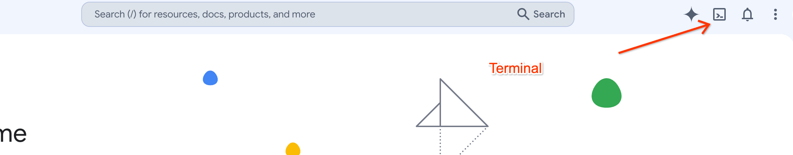

# Gemini Enterprise Eval Studio

<div align="center">
  
</div>

## Overview

Gemini Enterprise Eval Studio is an evaluation framework designed to execute
stateless API calls against Gemini Enterprise for E2E evaluation.
It enables customers to run batch evaluations, compare baselines, measure
streaming latency metrics (TTFT, TTFA, TTLT, Grounding Latency, Tool Execution
Latency), and define custom metrics using auto-grader rubrics or programmatic
evaluators.

## Motivation

Quality assurance is a major friction point for Gemini Enterprise
implementations. Enterprise customers require secure, client-side tools to
evaluate model performance, accuracy, and streaming latency on custom
collections without relying on externally hosted evaluation platforms that
violate data privacy policies.

## Key Features

-   **Client-Side Stateless Execution**: Direct API communication using end-user
    tokens, ensuring data privacy.
-   **Multi-Turn Conversation Evaluation**: Group queries by `conversation_id`
    (with consecutive `turn` numbers starting at `0` or `1`) to evaluate
    multi-turn conversations with full Assistant session context threading.
-   **Latency Telemetry Capture**: Calculate and expose Time to First Token
    (TTFT), Time To First Answer Token (TTFA), and Time To Last Token (TTLT) in seconds (s).
-   **Dual Metric Definition**: Support for both LLM-as-a-Judge rubrics and
    programmatic evaluator modules.

## CSV Dataset Format

For **Run Evaluation**, your input CSV must include `query` and `golden` columns. To evaluate **multi-turn conversations**, include the `conversation_id` and `turn` columns:

| Column | Required | Description |
| :--- | :---: | :--- |
| `query` | Yes | The user prompt or question sent to the Assistant. |
| `golden` | Yes | The expected ideal response used by the auto-rater. |
| `conversation_id` | No | Groups rows into a single multi-turn conversation sharing session context across turns. Rows without a `conversation_id` run as independent single-turn queries. |
| `turn` | No (Required if `conversation_id` is set) | Consecutive numeric turn order within a `conversation_id` starting at `0` or `1` (e.g., `1`, `2`, `3`). If a turn ID is missing or non-consecutive, all remaining rows in that conversation are marked `SKIPPED: Incorrect or missing turn ID.` |

## Data Privacy and Governance

To ensure security and compliance with enterprise data policies, Gemini
Enterprise Eval Studio is designed with a strict client-side, stateless
architecture:

1.  **GCP Tenant Isolation**: The tool operates entirely within the user's
    Google Cloud Platform (GCP) tenant. All computations, evaluation runs, and
    data storage occur within your controlled environment.
2.  **No Google Data Collection**: Google does not collect, store, or have
    access to your customer data, queries, evaluation inputs, or evaluation
    results processed by this tool. There are no telemetry pings, usage analytics,
    or error reporting sent to any Google-owned project.
3.  **Governing Agreements**: Any data handling and API calls made by the tool
    are governed solely by the customer's existing agreements with Google Cloud
    for the specific APIs used (e.g., Vertex AI APIs).
4.  **Token Storage & Firestore Retention Policy by Auth Provider**:
    - **SAML**: No credentials or tokens are stored in Firestore. SAML authentication assertions are processed statelessly without storing refresh tokens.
    - **Google Identity & 3P OIDC**: If server-side token storage in Firestore is enabled (`firestore_config`), user refresh tokens are stored in your GCP project's Firestore database. Administrators can configure `firestore_config.ttlSeconds` to control how long refresh tokens remain valid/stored before users are required to sign in again (defaults to 7 days).
    - **Firestore Purge Latency**: Expired tokens in Firestore are automatically purged under a TTL policy, which typically deletes expired documents within 24–72 hours of expiration. Please ensure this retention window satisfies your compliance requirements.

## Prerequisites & Setup

Gemini Enterprise Eval Studio supports two operational modes depending on your environment:

- **Auth Mode (Production / Team Deployment)**: Users authenticate via Google Workspace (Google Identity) or external Identity Providers (OIDC / SAML) using Workforce Identity Federation. Sessions are encrypted, and server-side refresh token persistence in Firestore is supported for **Google Workspace (`google_identity`)** and **OIDC (`3p_oidc`)** providers to extend sessions beyond 1 hour. Note: **SAML (`3p_saml`) providers do not support refresh tokens**; SAML sessions expire after 1 hour and require re-authentication.
- **No-Auth Mode (Client-Side / Quick Testing)**: The application runs as a **frontend-only site** without a backend server. Users authenticate by directly inputting a temporary Google Cloud access token into the UI.

### 1. Common Prerequisites (API Enablement)

In the Google Cloud Console, navigate to **APIs & Services > Library** and enable the following APIs for your GCP project:
1. **Agent Platform API** (`agentplatform.googleapis.com`)
2. **Discovery Engine API** (`discoveryengine.googleapis.com`)

### 2. Auth Mode Setup

1. **Identity Provider Credentials**:
   - **Google Workspace (`google_identity`)**: [Create an OAuth 2.0 Client ID](https://cloud.google.com/iam/docs/creating-managing-oauth-clients) in your Google Cloud Console. Set the Authorized Redirect URIs to include `http://localhost:3000/auth/callback` (or your production domain).
   - **Third-Party Providers (`3p_oidc` / `3p_saml`)**: [Set up Workforce Identity Federation (WIF)](https://cloud.google.com/iam/docs/workforce-identity-federation) in GCP by creating a Workforce Pool and Provider. Register an OIDC or SAML application in your external IdP (e.g., Okta, Entra ID) and set the callback URI to `http://localhost:3000/auth/callback`.
     > **Security Recommendation**: Configure attribute conditions or conditional access policies in your Workforce Identity Federation (WIF) Provider or external IdP to restrict access strictly to authorized business users and prevent unauthorized login by non-business accounts.
2. **Secret Manager (Optional but recommended)**:
   - Store your OAuth client secret and session encryption key in GCP Secret Manager and use their URIs in `config.json`.
3. **Application Configuration (`config.json`)**:
   - Create a `config.json` file in the root directory based on `config.json.example`.
   - Configure `session_config.encryption_key_secret` (can be a 32-character string for local dev) and your `auth_providers` array.
   - *(Optional)* Configure `firestore_config` to enable server-side refresh token storage in Firestore (requires a database created in **Firestore Native mode**), extending user sessions beyond 1 hour for Google Identity and OIDC providers.
   - *(Optional)* Configure `trusted_hosts` array to allowlist custom hostnames for authentication redirects.

### 3. No-Auth Mode Setup

In No-Auth Mode, the application operates as a standalone frontend-only web application without requiring a backend server or identity provider configuration.

1. Obtain a temporary Google Cloud access token by running the following command in your terminal (or open Cloud Shell using the terminal icon on the top right of the Google Cloud Console):

    ```sh
    gcloud auth print-access-token
    ```
    *Note: Access tokens are short-lived and will need to be refreshed periodically.*

2. Input the generated access token directly into the configuration screen in the application's UI.

    <p align="center">
      
    </p>

## Running Locally

To run the application locally using `npm`, first install dependencies:

```sh
npm ci
```

Then start the server in either **Auth Mode** (full stack) or **No-Auth Mode** (client-side frontend only):

- **Running in Auth Mode (Full Stack with Backend Express Server)**:
  ```sh
  npm run start:auth
  ```
  This starts both the Node.js Express backend server (default port 3000) and the Angular frontend development server configured to proxy API requests to the backend.

- **Running in No-Auth Mode (Client-Side Frontend Only)**:
  ```sh
  npm run start:no-auth
  ```
  By default, the frontend listens on port 4200.

## Running with Docker

Gemini Enterprise Eval Studio includes a multi-stage `Dockerfile` that packages both the compiled Angular SPA and the Node.js Express backend server into a single production container image.

### 1. Build the Image
```sh
docker build -t gemini-enterprise-eval-studio .
```

### 2. Run the Container
```sh
docker run -d \
  -p 8080:8080 \
  -v $(pwd)/config.json:/app/config.json \
  --name eval-studio \
  gemini-enterprise-eval-studio
```

### Configuration Options:
- **Port Mapping**: Map the container to any host port using `-p <host_port>:8080` (e.g. `-p 3000:8080` to access the application at `http://localhost:3000`).
- **Port Environment Variable**: If you wish to change the container's internal listening port, pass `-e PORT=<port>` (defaults to `8080`).
- **Configuration File**: Mount your `config.json` into `/app/config.json` via `-v` volume mount, or specify a custom path inside the container using `-e CONFIG_PATH=/path/to/config.json`.

### 3. Deploy to Cloud Run
You can deploy the application directly to Cloud Run from source. Cloud Run will automatically build the container image using the `Dockerfile` and deploy the service:

```sh
gcloud run deploy gemini-enterprise-eval-studio \
  --project=<PROJECT_ID> \
  --region=<REGION> \
  --source=.
```

## Uninstall and Resource Deletion

To completely uninstall Gemini Enterprise Eval Studio and delete all associated data and resources from your GCP project:

1. **Stop or Remove Application Deployment**:
   - Terminate the local application server or container process. To verify the backend server is down, ping the `/healthz` endpoint (e.g., `curl http://localhost:3000/healthz`); it should fail to connect.
   - If deployed to a cloud environment (e.g., Cloud Run, App Engine), delete the deployed service or instance.

2. **Delete Firestore Session Data**:
   - If Firestore token storage was enabled (`firestore_config`), navigate to **Firestore** in the Google Cloud Console and delete the session/token collections.
   - Alternatively, delete the Firestore database instance if it was created solely for this tool. Note: If relying on TTL expiration rather than manual deletion, expired documents are automatically purged by Firestore within 24–72 hours.

3. **Remove Identity Provider Credentials & WIF**:
   - Delete the OAuth 2.0 Client ID under **APIs & Services > Credentials** in your GCP project.
   - If Workforce Identity Federation (WIF) was configured, delete the Workforce Pool and Provider under **IAM & Admin > Workforce Identity Pools**.

4. **Delete Stored Secrets & Disable APIs (Optional)**:
   - Delete any stored secrets in **Secret Manager** (such as OAuth client secrets or session encryption keys).
   - Disable the Agent Platform API and Discovery Engine API under **APIs & Services > Enabled APIs & Services** if they are no longer needed.
